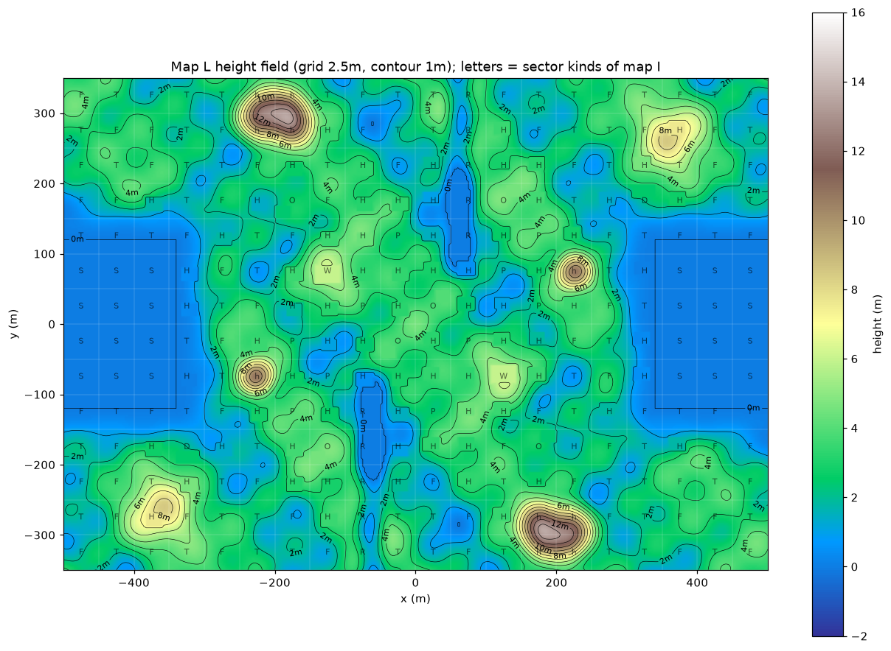

# 地面全体の起伏（高さの格子）とマップL

2026-11-25 Claude（系統「地形」、ワークツリー `FutureBattle-terrain`、ブランチ `terrain`）。

## 1. 依頼と方針

- 依頼（11-25）：「現在は地面が完全に平面です、全体的に傾斜や地形について実装できますか？」
- これまでの高さは「長方形の平らな面と一方向の坂」の表（`BattleTerrain::FHeightPatch`）で、丘（G・H・I・J・K）と2階を表していた。地面そのものは高さ0の平らな箱。
- 方針：**地面全体を高さの格子にする仕組み**を足し、**新しいマップL**（マップIの区画・道・川・家・拠点・規則をそのまま使い、地面に起伏を付けたもの）で使う。A〜K の地図・試合は変えない（格子が空のマップでは計算が以前と同じ）。I と L を比べれば地形の効果だけを見られる。
- 既存のマップ（I・J・K など）に起伏を入れるかは、L を見てからユーザーが決める。

（図は `Setup/Preview-MapLHeights.py` で、C++ と同じ式から作る。）

## 2. 仕組み

| 部分 | 中身 | 場所 |
|---|---|---|
| 高さの格子 | 2.5m ごとの点の高さ。点の間は1マスを対角線 (I,J)–(I+1,J+1) で切った2つの平らな三角形。格子は原点を中心に点対称 | `BattleTerrain::FHeightField`（`BattleTerrain.h`） |
| 高さの表との合流 | `FHeights::Field`。地面の高さ（他のマップの0）が格子になり、家の2階・階段はその上に載る。`Ground`・`Lift`・`Base` がそのまま格子を使うので、多数兵の移動（`TerrainStep`）、区画の中心、命令の目的地、霧の格子、区画の表示は手を入れずに地形に沿う | `BattleTerrain.h` |
| 地面の網目 | 格子と同じ点・同じ三角形で作る静的メッシュ（100m 四方×70枚、`Content/Prototype/Terrain/L/`）。当たりは網目そのもの（complex as simple）。表と当たりは丸め誤差の範囲で一致する | `BuildGroundTiles`（`BattleMapCommandlet.cpp`） |
| 地面の塗り | 点ごとの色（草・畑・林・街・本拠地・道・水・橋・浅瀬・拠点と本拠地の印）。高い所はやや明るく、高さ2m ごとに暗い等高線。マップI の地面に置いていた薄い箱（道・畑・川・印）は坂に沿わないので使わない | `BuildTerrainL`（同上）、材質 `M_GroundVertex`（頂点の色） |
| 物の置き方 | 地面に立つ物は、その場所の地面の高さに置き、下は足元の一番低い地面の20cm下まで伸ばす（坂ですき間が出ない）。4m より長い物で足元が20cm より変わるものは3m 以下に分けて地面に沿わせる（坂の上の塀）。地面より上の物（木の葉・2階の床）は真ん中の地面の高さだけ上げる | `Box`（同上） |
| ナビメッシュ | 地面の最低から最高の2階の上までを1つの範囲で作る。車・小屋・木箱の上に歩ける島ができないよう、すべての障害物に「通れない」修飾（`UNavModifierComponent`＋`NavArea_Null`）を付ける（平らなマップは高さ1.25m までの薄い範囲で島を防いでいた）。川の通れない範囲は地面の高さに合わせる | 同上 |

## 3. マップLの地形（数値は叩き台）

| 部分 | 値 |
|---|---|
| 広さ・格子 | 1000m × 700m（マップIと同じ）、2.5m 格子（401 × 281 点） |
| 起伏 | 基準2.6m に4つの波（振幅 1.1m・0.8m・0.55m・0.35m、波長 70〜400m）。どれも点対称 |
| 丘 | マップI の小丘（拠点の街の東の縁、見張り所）：高さ6m・裾の半径40m。尾根（南の道の南）：高さ10m、稜線 185〜215m、裾の半径60m。どちらも滑らかな丘（I は箱と坂） |
| ゆるい高まり | 北の畑（中心 (360, 270)m、4.5m・半径90m）、街の南側（中心 (125, −65)m、3m・半径80m） |
| 川 | 川筋に沿って深さ3m・幅±32m の浅い谷（川は谷底） |
| 本拠地 | 出発の列・雇用の場所・補給の判定が高さ0を前提にしているので、x が 340m より外・\|y\| が 120m 以内は高さ0の平地。そこから90m で周りの高さへ上がる |
| 家・倉庫の土台 | 86か所。真ん中の地面の高さで、建物＋3m を平らにする。周りは「土台から外へ25%（14°）より急にしない」で切り土・盛り土（周りの地面がもともと急なら、その急さのまま） |
| 結果（`Preview-MapLHeights.py`） | 高さ 0〜13.6m（小丘の頂上10.7m、尾根の頂上13.1m）、坂の平均 5.2%・90% 点 10.5%・最大 29.8%（16.6°）、土台の平らさのずれ 0cm、点対称のずれ 0 |

地形だけ（建物・遮蔽なし）で遮られる見通しの割合（格子からの計算、無作為の約2500本ずつ）：

| 距離 | 立った目の高さ 1.5m 同士 | しゃがんだ 1.0m 同士 |
|---|---|---|
| 50〜100m | 10% | 20% |
| 100〜150m | 22% | 40% |
| 150〜200m | 33% | 51% |
| 200〜300m | 50% | 64% |

最初の案は丘の裾が家の土台にかかり、土台の縁で最大92%（42°）の坂ができた。尾根の稜線を短くし、小丘の裾を40m にし、土台の周りを傾きの上限で作る方式に変えて30% 以下にした。

## 4. 実行時に直した所（L だけが通る。他のマップは同じ動き）

- 作戦画面のカメラ：注視点の高さを足元の地面に合わせる（最低の10m で丘の中に入らない）。`ABattleController::PlayerTick`。
- 2階の家で Alt を押して1階を選ぶ：1階の床を「高さ0」ではなく「2階の床の3.2m 下」にした（他のマップでは同じ値）。`ABattleController::PickOrderPoint`。
- マップの数値監査（`Test-MapStats`）：調べる点を地面の高さに置く。
- 前線の川越え（`BattleFrontLine.cpp`）：マップI の川の扱いを L にも使う。

## 5. 確かめ方

- 生成の自己点検（`Setup/Initialize-MapL.ps1`、`TERRAIN_FIELD_RESULT failures=0` が必須）：
  - 10m ごとの7000点で、表の高さと網目を下に撃った高さが3cm 以内（障害物の上の点は除く）。
  - 幅70cm 以上の障害物の上面にナビメッシュが無い。
  - 2階・小丘と尾根の頂上へ西の本拠地から歩いて届く。
  - マップI と同じ点検（本拠地と拠点がつながる、川は橋と浅瀬だけで渡れる、区画ごとの遮蔽）を地面の高さで行う。
- `Test-Battle.ps1`（A〜K が変わらないこと）、マップL で1試合（完走・移動の詰まり・兵が地面に沿うか）、描画ありの画面。

## 6. 制限と次の一手

- AI は地形を「見通しを遮る物」としてしか使わない。高所を選ぶ判断・反斜面に隠れる判断は無い（`Docs/design-height-tactics.md` の 3.3〜3.5 が次の候補）。
- 車両は坂で車体が傾かない（向きだけ回る。見た目のみ）。
- 道路は地形どおりに上り下りする（切り通し・盛り土の道は作っていない）。
- 遠くのVAT表示の兵・死体・効果は、各兵の位置の高さを使うので地形に沿う見込みだが、画面で確かめてから判断する。
- 既存のマップ（I・J・K）に起伏を入れるか、L の起伏を強める・弱めるかは、L を遊んでからユーザーが決める。
